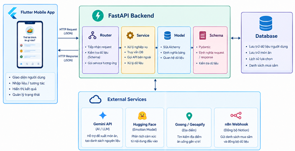
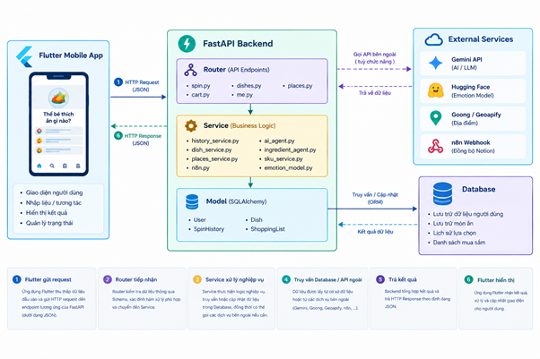

# Thế bé thích ăn gì nào?

Ứng dụng di động (Flutter, Android) gợi ý món ăn theo cảm xúc. Người dùng nhập một câu mô tả tâm trạng; hệ thống nhận diện cảm xúc (PhoBERT), kết hợp thời tiết để gợi ý 10 món (Gemini) và dùng vòng quay chọn ngẫu nhiên một món. Sau đó người dùng chọn **ăn ngoài** (tìm quán gần đây, bản đồ, chỉ đường) hoặc **tự nấu** (nguyên liệu cho 2 người, giỏ hàng ước tính theo sản phẩm Bách Hóa Xanh).

## Tính năng

- **Gợi ý món theo cảm xúc:** nhập một câu mô tả tâm trạng, nhận 10 món gợi ý, vòng quay chọn 1 món.
- **Duyệt món:** danh sách, tìm kiếm không dấu (gõ "pho" ra "Phở bò"), lọc theo nhóm, xem chi tiết.
- **Ăn ngoài:** quán gần đây (Goong, dự phòng Geoapify), bản đồ OpenStreetMap, chỉ đường bằng Google Maps.
- **Tự nấu:** nguyên liệu cho 2 người (AI sinh ở lần đầu rồi lưu vào CSDL), giỏ hàng (danh mục Bách Hóa Xanh giả lập, tổng tiền ước tính, mục "Tự mua"), lưu giỏ hàng gần nhất bằng SQLite để xem khi mất mạng.
- **Tài khoản (Supabase Auth):** email, quên mật khẩu, Google, GitHub; có chế độ khách (không cần đăng nhập).
- **Lịch sử chọn món** cho người đã đăng nhập; AI dùng các món gần đây để tránh gợi ý lặp lại.

## Kiến trúc





Ứng dụng Flutter gọi REST API của backend FastAPI. Khi người dùng đã đăng nhập, ứng dụng gửi kèm token JWT do Supabase Auth cấp; backend kiểm tra token bằng khóa công khai (JWKS) của Supabase. Khóa API của các dịch vụ bên ngoài (Gemini, Goong, thời tiết) chỉ nằm ở backend.

## Công nghệ

| Thành phần | Công nghệ |
|---|---|
| Ứng dụng | Flutter (Dart), Provider, gói `http`, SQLite (`sqflite`), `flutter_map` + OpenStreetMap, `url_launcher` |
| Backend | Python, FastAPI, SQLAlchemy |
| Cơ sở dữ liệu | PostgreSQL trên Supabase |
| AI | PhoBERT (PyTorch, Transformers), Gemini API |
| Địa điểm / thời tiết | Goong Place API (dự phòng Geoapify), OpenWeatherMap |
| Xác thực (máy chủ) | Supabase Auth, JWT (PyJWT) |
| Kiểm thử | pytest |

## Cấu trúc thư mục

```
.
├── backend/
│   ├── app/
│   │   ├── core/          # cấu hình (config), xác thực JWT (auth)
│   │   ├── db/            # kết nối và mô hình SQLAlchemy
│   │   ├── routers/       # spin, places, dishes, cart, me
│   │   ├── schemas/       # Pydantic
│   │   └── services/      # AI, tìm quán, nguyên liệu, giỏ hàng, lịch sử...
│   ├── data/              # danh sách món ăn, danh mục sản phẩm giả lập (sku_catalog.csv)
│   ├── scripts/           # script nhập dữ liệu, làm nóng cache nguyên liệu
│   ├── tests/             # kiểm thử tự động
│   └── .env_sample
└── frontend/              # ứng dụng Flutter (lib/: models, services, provider, screens)
```

## Cài đặt và chạy

### Yêu cầu

- Python 3.12 trở lên, Flutter SDK 3.47.7 
- Một dự án Supabase (PostgreSQL + Auth)
- Khóa API: Gemini, OpenWeatherMap, Goong (hoặc Geoapify)

### Backend

```bash
cd backend
python -m venv venv
# Windows (PowerShell): .\venv\Scripts\Activate.ps1
# macOS / Linux:        source venv/bin/activate
pip install -r requirements.txt

# Tạo file cấu hình rồi điền giá trị (không commit file .env)
cp .env_sample .env          # Windows: copy .env_sample .env

uvicorn app.main:app --reload --host 0.0.0.0 --port 8000
```

Tài liệu API tương tác (Swagger): http://localhost:8000/docs. `--host 0.0.0.0` để máy ảo hoặc điện thoại cùng mạng truy cập được.

**Dữ liệu lần đầu:** các bảng được tạo khi backend khởi động. Nhập danh sách món và (tùy chọn) làm nóng cache nguyên liệu:

```bash
python -m scripts.import_dishes        # [CẦN XÁC NHẬN: tên script, đường dẫn CSV]
python -m scripts.warm_ingredients     # [CẦN XÁC NHẬN: tên script]; nguyên liệu cũng tự sinh ở lần gọi API đầu tiên
```

**Mô hình PhoBERT:** Link : https://huggingface.co/CALLMEKANEKI/phobert-emotion-multitask

### Biến môi trường (`backend/.env`)

| Biến | Bắt buộc | Mô tả |
|---|---|---|
| `DATABASE_URL` | Có | Chuỗi kết nối PostgreSQL (Supabase) |
| `GEMINI_API_KEY` | Có | Khóa Gemini API |
| `SUPABASE_URL` | Có (nếu dùng đăng nhập) | URL dự án Supabase, dùng để kiểm tra JWT |
| `SUPABASE_JWT_SECRET` | Không | Chỉ cần khi dự án Supabase còn dùng khóa ký HS256 cũ |
| `WEATHER_API_KEY` | Không | OpenWeatherMap; thiếu thì bỏ qua thông tin thời tiết |
| `MAP_PROVIDER` | Không | `goong` (mặc định) hoặc `geoapify` |
| `GOONG_API_KEY` | Nếu dùng Goong | Khóa Goong Place API |
| `GEOAPIFY_API_KEY` | Nếu dùng Geoapify / làm dự phòng | Khóa Geoapify |
| `HF_TOKEN`, `HF_MODEL_REPO` | **[CẦN XÁC NHẬN]** | Tải mô hình từ Hugging Face |
| `N8N_BHX_WEBHOOK_URL` | Không | Tùy chọn: gửi giỏ hàng sang webhook n8n. Để trống thì bỏ qua |

### Ứng dụng Flutter

```bash
cd frontend
flutter pub get
flutter run                                                     # máy ảo Android: backend mặc định http://10.0.2.2:8000
flutter run --dart-define=API_BASE_URL=http://<IP-máy-chạy-backend>:8000   # thiết bị thật cùng Wi-Fi
```

Cấu hình Supabase trong ứng dụng (URL và khóa công khai anon/publishable): **[CẦN XÁC NHẬN: cách cung cấp, ví dụ `--dart-define` hay hằng số]**. Không đưa khóa `service_role` vào ứng dụng. Cấu hình đăng nhập Google/GitHub: **[CẦN XÁC NHẬN: redirect URL của ứng dụng]**.

## API chính

| Phương thức | Đường dẫn | Chức năng | Đăng nhập |
|---|---|---|---|
| POST | `/api/v1/spin/recommend` | Gợi ý 10 món theo cảm xúc | Không bắt buộc |
| POST | `/api/v1/spin/select` | Ghi món đã chọn (khách: không ghi) | Không bắt buộc |
| GET | `/api/v1/spin/history` | Lịch sử món đã chọn | Bắt buộc |
| GET | `/api/v1/dishes` | Danh sách món (tìm kiếm, lọc, phân trang) | Không |
| GET | `/api/v1/dishes/categories` | Nhóm món | Không |
| GET | `/api/v1/dishes/{id}` | Chi tiết món | Không |
| GET | `/api/v1/dishes/{id}/ingredients` | Nguyên liệu cho 2 người | Không |
| POST | `/api/v1/places/nearby` | Quán ăn gần vị trí | Không |
| POST | `/api/v1/cart` | Giỏ hàng và tổng tiền ước tính | Không |
| GET | `/api/v1/me` | Thông tin tài khoản | Bắt buộc |
| GET | `/health` | Kiểm tra hoạt động | Không |

## Kiểm thử

```bash
cd backend
pip install -r requirements-dev.txt
python -m pytest -q          # 90 test, chạy không cần mạng hay cơ sở dữ liệu thật
```

## Hạn chế đã biết

- Tìm quán dựa trên tên quán, không theo thực đơn; dữ liệu không có đánh giá sao.
- Danh mục sản phẩm Bách Hóa Xanh do nhóm tự soạn (khoảng 130 dòng), một số nguyên liệu chưa có; giá chỉ để tham khảo. Ứng dụng không đặt hàng và không thanh toán.
- Gợi ý và nguyên liệu do AI sinh nên mang tính tham khảo; phản hồi mất vài giây và phụ thuộc hạn mức miễn phí của dịch vụ bên ngoài.
- **[CẦN XÁC NHẬN: backend chạy trên máy phát triển, chưa triển khai; mới kiểm thử trên Android]**

## English summary

**"What does the little one want to eat?"** is an Android app (Flutter) that suggests Vietnamese dishes from the user's mood. A FastAPI backend detects emotion with PhoBERT, combines it with the weather, asks Gemini to pick 10 dishes from a database, and a spin wheel chooses one. The user can then find nearby restaurants (map and directions) or cook at home (ingredient list and an estimated shopping cart from a mock grocery catalog). Accounts use Supabase Auth (email, Google, GitHub), with a guest mode. The data and UI are in Vietnamese by design.

## Ghi chú bảo mật

Không commit `.env`, khóa API, token hay tệp mô hình. Chỉ `.env_sample` (giá trị trống) nằm trong repo.